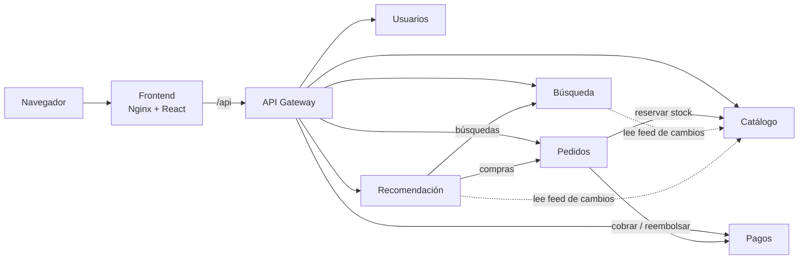

# Univalle Shop

Tienda virtual exclusiva para la comunidad de la **Universidad del Valle**: estudiantes, docentes y administrativos. Proyecto del curso **Desarrollo de Software 3**.

El sistema está formado por **6 microservicios en NestJS**, cada uno con **arquitectura hexagonal** y su propia base **MongoDB**. Delante de ellos hay un **API Gateway**, que es el único punto de entrada, y un frontend en **React**. Todo se levanta con **Docker Compose**.

## Inicio rápido

Requisitos: Docker con Docker Compose.

```bash
cp .env.example .env
sudo docker compose up -d --build
```

### En Windows

Instala **Docker Desktop** y déjalo abierto antes de empezar. Cambia el comando para copiar el `.env` y no se usa `sudo`:

```powershell
# PowerShell
Copy-Item .env.example .env
docker compose up -d --build
```

```cmd
:: CMD (Símbolo del sistema)
copy .env.example .env
docker compose up -d --build
```

Para correr las pruebas sin Docker hace falta **Node.js**. En PowerShell: `cd services\users; npm install; npm test`.

### Abrir la aplicación

La primera vez tarda unos minutos mientras construye las imágenes. Luego abre:

| Qué | Dirección |
|---|---|
| Tienda (frontend) | <http://localhost:8080> |
| API Gateway | <http://localhost:3000/api> |
| Estado de todos los servicios | <http://localhost:3000/api/health> |
| Correos de verificación (MailHog) | <http://localhost:8025> |

La guía completa, con desarrollo local, pruebas y solución de problemas, está en [docs/guia-ejecucion.md](docs/guia-ejecucion.md).

### Cuentas y datos de prueba

- **Administrador:** `admin@univalleshop.local` / `Admin12345` (se configura en `.env`).
- **Cliente nuevo:** regístrate con un correo `@correounivalle.edu.co` o `@univalle.edu.co`. El código de verificación llega a MailHog (<http://localhost:8025>), no a tu bandeja real.
- **Catálogo de ejemplo:** 3 categorías y 9 productos se crean solos la primera vez (`SEED_DEMO_DATA=true`).
- **Tarjetas de prueba** (el pago es simulado):

| Tarjeta | Resultado |
|---|---|
| `4242 4242 4242 4242` (o cualquier número válido) | Aprobada |
| `4000 0000 0000 0002` | Rechazada: fondos insuficientes |
| `4000 0000 0000 0069` | Rechazada: tarjeta reportada |

Con cualquier vencimiento futuro y un CVV de 3 dígitos.

## Componentes

| Componente | Carpeta | Puerto | Responsabilidad |
|---|---|---|---|
| Frontend | [`frontend/`](frontend/README.md) | 8080 (publicado) | Interfaz web en React servida por Nginx |
| API Gateway | [`gateway/`](gateway/README.md) | 3000 (publicado) | Entrada única: enrutamiento, JWT, roles, límite de peticiones, circuit breaker |
| Usuarios | [`services/users/`](services/users/README.md) | 3001 | Registro con correo institucional, verificación, login (emite el JWT), perfil y direcciones |
| Catálogo | [`services/catalog/`](services/catalog/README.md) | 3002 | Productos, categorías, inventario y reservas de stock |
| Pedidos | [`services/orders/`](services/orders/README.md) | 3003 | Carrito, compra (checkout), historial y conciliación de cobros |
| Pagos | [`services/payments/`](services/payments/README.md) | 3004 | Cobros con pasarela simulada y reembolsos |
| Búsqueda | [`services/search/`](services/search/README.md) | 3005 | Índice propio de productos, búsqueda con filtros y búsquedas recientes |
| Recomendación | [`services/recommendation/`](services/recommendation/README.md) | 3006 | Sugerencias según compras y búsquedas, populares y relacionados |

Cada microservicio tiene su propia base MongoDB (`mongo-users`, `mongo-catalog`…), y ningún servicio accede a la base de otro. Solo el frontend, el gateway y MailHog publican puertos. Los microservicios únicamente son accesibles dentro de la red de Docker.

## Arquitectura



Los detalles están en [docs/architecture/arquitectura.md](docs/architecture/arquitectura.md): capas hexagonales, flujo de compra, sincronización, resiliencia y seguridad.

**En resumen:**
- **Hexagonal:** en cada servicio, `domain` (TypeScript puro), `application` (casos de uso y puertos) e `infrastructure` (adaptadores: HTTP, Mongoose, clientes REST).
- **SOLID:** los casos de uso dependen de interfaces. El `app.module.ts` de cada servicio es el único lugar que conecta cada puerto con su adaptador.
- **Resiliencia:** timeouts y circuit breaker en todas las llamadas entre servicios, más copias locales de los datos y caché de señales. Si un servicio cae, el resto sigue funcionando.

## Pruebas

Cada componente tiene pruebas unitarias del dominio y de los casos de uso (Vitest), con adaptadores falsos en memoria. No necesitan Docker ni MongoDB.

```bash
cd services/users && npm install && npm test
```

| Componente | Pruebas |
|---|---|
| Usuarios | 52 |
| Catálogo | 33 |
| Pedidos | 26 |
| Pagos | 14 |
| Búsqueda | 15 |
| Recomendación | 12 |
| API Gateway | 25 |
| **Total** | **177** |

## Tecnologías

NestJS 12 (ESM) · TypeScript · Mongoose / MongoDB 7 · React 19 + React Router 7 + Vite · Vitest · Docker Compose · Nginx · MailHog.

## Documentación

- [Guía de ejecución](docs/guia-ejecucion.md)
- [Arquitectura](docs/architecture/arquitectura.md)
- [Decisiones del proyecto](docs/decisiones.md)
- [Guía de contribución (ramas y commits)](CONTRIBUTING.md)
- Checklists: [Microservicios](docs/checklists/microservicios.md) · [Arquitectura Hexagonal](docs/checklists/arquitectura-hexagonal.md)
