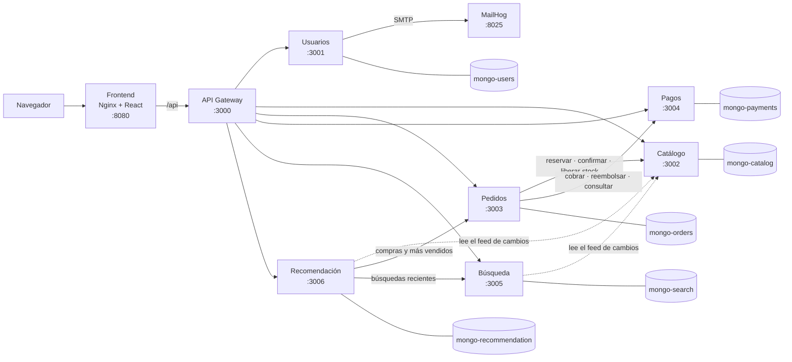
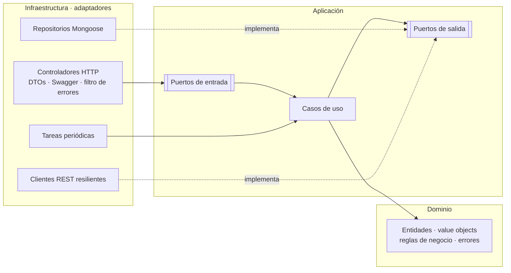
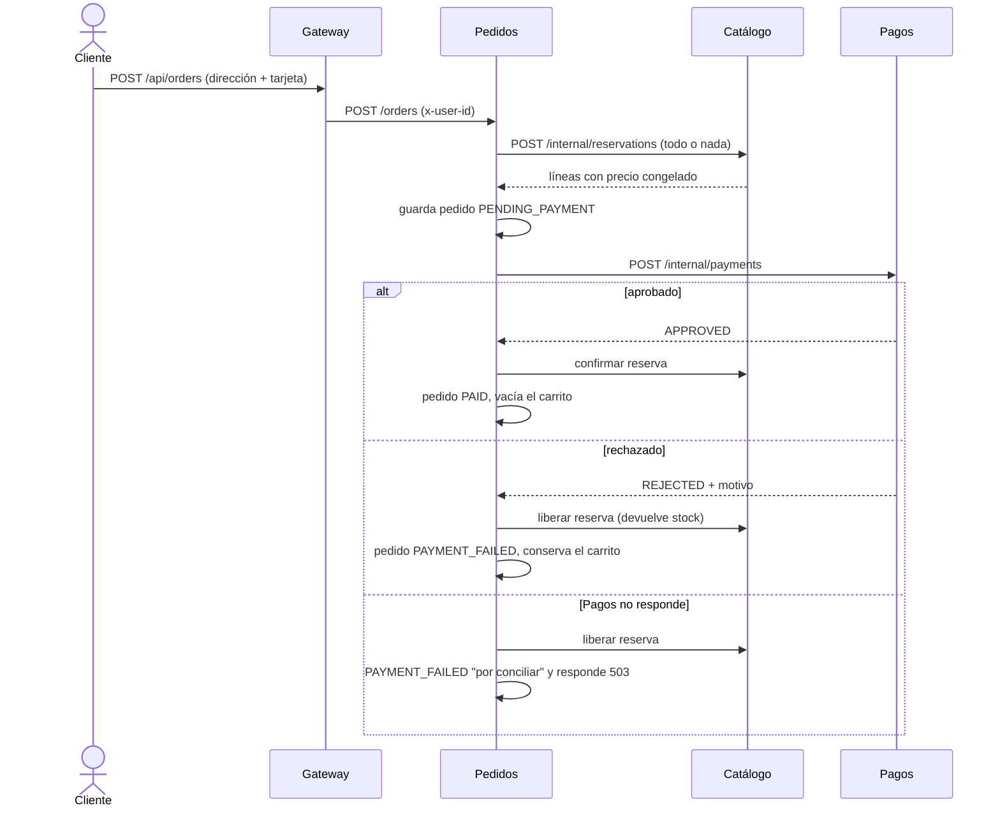

# Arquitectura de Univalle Shop

## 1. Vista general



- Los 15 contenedores corren en la red interna `backend` de Docker Compose.
- Solo se publican hacia fuera el **frontend** (8080), el **gateway** (3000) y la interfaz de **MailHog** (8025).
- Las flechas continuas son llamadas REST en el momento de la petición. Las punteadas son sincronizaciones periódicas.

## 2. Reglas de la arquitectura

1. **Un punto de entrada.** El navegador solo habla con Nginx, y Nginx reenvía `/api` al gateway. Así el navegador usa un solo origen y no necesita CORS.
2. **Seguridad centralizada en el gateway:**
   - Usuarios emite el JWT y el gateway lo valida (firma HS256, emisor y vencimiento).
   - Aplica el nivel de acceso de cada ruta (público, con sesión o solo admin).
   - Borra cualquier cabecera `x-user-*` que envíe el cliente y reenvía la identidad real (`x-user-id`, `x-user-email`, `x-user-role`).
   - Los servicios vuelven a revisar el rol en sus rutas de administración (defensa en profundidad).
3. **Una base de datos por servicio.** Ningún servicio lee ni escribe la base de otro. Si necesita un dato ajeno, lo pide por REST o mantiene su propia copia.
4. **Comunicación solo por REST**, con JSON. Los servicios no comparten código: el contrato es el JSON que intercambian.
5. **Rutas internas.** Las rutas `/internal/*` las usan otros servicios dentro de la red de Docker. El gateway no tiene ninguna ruta hacia ellas.

## 3. Arquitectura hexagonal dentro de cada servicio



```
src/
├── domain/            # TypeScript puro: entidades, value objects, servicios de dominio y errores
├── application/
│   ├── ports/in/      # contratos de los casos de uso (+ tokens de inyección)
│   ├── ports/out/     # repositorios, clientes de otros servicios, reloj, generador de ids…
│   ├── use-cases/     # una clase por operación de negocio
│   ├── services/      # lógica de aplicación compartida entre casos de uso
│   └── views/         # objetos planos que se devuelven hacia fuera
├── infrastructure/
│   ├── http/          # controladores, DTOs, guards de identidad, filtro de errores
│   ├── persistence/   # esquemas y repositorios Mongoose
│   ├── clients/       # clientes REST con timeout y circuit breaker
│   ├── jobs/          # tareas periódicas (sincronización, conciliación)
│   └── config/        # lectura y validación de variables de entorno
├── app.module.ts      # composición: conecta cada puerto con su adaptador
└── main.ts            # arranque: validación, filtro de errores, Swagger
```

**Reglas que se cumplen en todos los servicios:**
- El dominio no importa NestJS, Mongoose ni ninguna librería de infraestructura.
- Los casos de uso son clases sin decoradores de NestJS que reciben sus puertos por constructor. `app.module.ts` los construye con fábricas (`useFactory`) y los registra bajo un token de su puerto de entrada.
- Los errores de negocio heredan de `DomainError` y declaran una categoría (`validation`, `not_found`, `conflict`, `unauthorized`, `forbidden`, `unavailable`). Un único filtro HTTP traduce cada categoría a su código de estado, así agregar un error no obliga a tocar el filtro.
- La hora y los identificadores vienen de puertos (`Clock`, `IdGenerator`), para que las pruebas sean deterministas.
- Las pruebas unitarias del dominio y de los casos de uso usan adaptadores en memoria: no necesitan base de datos ni red.

## 4. Flujo de compra (saga con compensación)



- **Inventario atómico.** Catálogo descuenta stock con una sola operación condicional de MongoDB (`stock >= unidades`). Probado con 25 compras simultáneas de 15 unidades: se aceptaron exactamente 15.
- **Idempotencia.** Reservar, confirmar, liberar, cobrar y reembolsar usan el id del pedido. Repetir la misma petición no descuenta, cobra ni devuelve dos veces.
- **Cancelación.** Primero se reembolsa en Pagos (si falla, no se cancela nada) y después se devuelve el stock.
- **Conciliación.** Si Pagos se cae durante un cobro, no se sabe si alcanzó a cobrar. Una tarea de Pedidos revisa periódicamente esos pedidos, consulta a Pagos y, si hubo cobro, lo reembolsa.

## 5. Sincronización de datos entre servicios

Búsqueda y Recomendación necesitan los productos, pero no leen la base de Catálogo:

1. Catálogo publica un **feed de cambios**: `GET /internal/products/changes?cursor=…`. Devuelve los productos modificados después del cursor, incluidos los desactivados y los cambios de stock.
2. Cada consumidor guarda su **propia copia** en su base y el **cursor** por el que va. Cada 10 s (Búsqueda) o 15 s (Recomendación) pide lo nuevo.
3. Catálogo no sabe que esos servicios existen, y agregar un consumidor no obliga a cambiarlo.
4. Si Catálogo se cae, ambos siguen funcionando con su copia y continúan desde el cursor cuando vuelve.

Recomendación además consulta las **compras** (Pedidos) y las **búsquedas recientes** (Búsqueda) de cada usuario, con un timeout corto, y guarda la última versión. Si alguno no responde, recomienda con lo guardado y lo indica con `degraded: true`.

## 6. Resiliencia

| Mecanismo | Dónde | Efecto |
|---|---|---|
| Timeout | Todas las llamadas entre servicios (gateway 5 s, Pedidos 4 s, señales de Recomendación 1,5 s) | Un servicio lento no bloquea a los demás |
| Circuit breaker | Gateway (uno por servicio) y clientes REST de Pedidos, Búsqueda y Recomendación | Tras 5 fallos seguidos (3 en Búsqueda y Recomendación) deja de llamar y falla en milisegundos; luego prueba con una sola petición |
| Degradación controlada | Pedidos (cambiar cantidades sin Catálogo), Búsqueda (índice propio), Recomendación (caché), frontend (respaldos visuales) | La función afectada empeora un poco en vez de fallar |
| Compensación | Compra: liberar stock si el pago no se aprueba | Nunca queda stock apartado de un pedido fallido |
| Conciliación | Pedidos ↔ Pagos | Nunca queda un cobro de un pedido fallido |
| Healthchecks | Cada contenedor (`/health`) y `GET /api/health` en el gateway | Docker y el equipo ven qué está sano |

## 7. Seguridad

- **Registro restringido** a dominios institucionales (`ALLOWED_EMAIL_DOMAINS`), con verificación del correo mediante un código de 6 dígitos que vence en 15 minutos y admite 5 intentos.
- **Contraseñas** con bcrypt. Política mínima: 8 caracteres, con letras y números.
- **Errores de login uniformes:** un correo inexistente y una contraseña incorrecta dan el mismo error, para no revelar qué correos tienen cuenta.
- **Límite de peticiones** en el gateway: 10 intentos por minuto en ingreso, registro y códigos; 300 por minuto en el resto. Se cuenta por usuario con sesión, o por IP sin sesión.
- **Tarjetas:** Pagos guarda solo la franquicia y los últimos 4 dígitos. Pedidos nunca guarda datos de la tarjeta.
- **Validación de entrada** con DTOs (`whitelist` + `forbidNonWhitelisted`): campos desconocidos, como `role` en el registro, se rechazan con 400.

## 8. Puertos y rutas públicas

| Componente | Dirección en tu máquina |
|---|---|
| Frontend | <http://localhost:8080> |
| API Gateway | <http://localhost:3000/api> |
| Estado del sistema | <http://localhost:3000/api/health> |
| MailHog | <http://localhost:8025> |

La tabla de rutas públicas del gateway está en [`gateway/README.md`](../../gateway/README.md).
